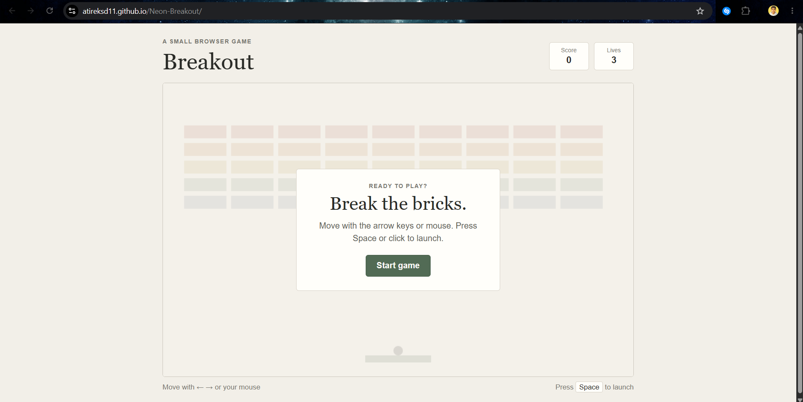
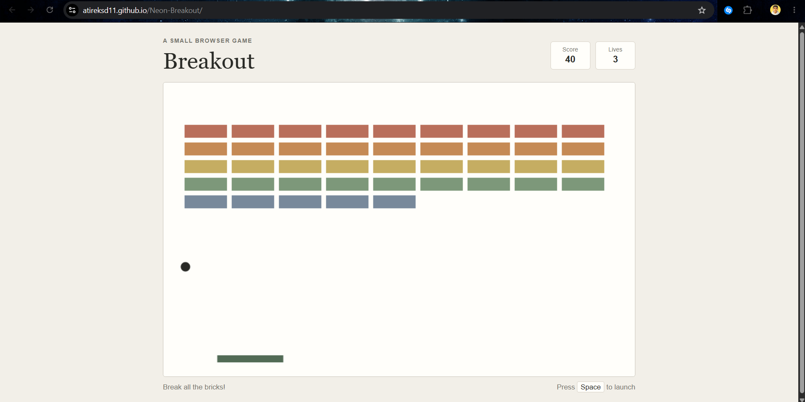

# Neon Breakout

Neon Breakout is a small browser game made with HTML, CSS, and JavaScript. Move the paddle to bounce the ball and clear the bricks before you run out of lives.

## How to play

- Click **Start game** to begin.
- Move the paddle with the **left and right arrow keys**, **A and D**, or your mouse.
- Press **Space** or click the game area to launch the ball.
- Keep the ball from falling below the paddle.
- Break all the bricks to win. You have three lives.

## Features

- Canvas based game
- Keyboard and mouse controls
- Score and lives display
- Win and game over screens
- Responsive page layout 

## Run it 

You don’t need to install any packages.

1. Download or clone this repository.
2. Open the project folder in VS Code.
3. Open `index.html` using a local server, such as the Live Server extension.
4. Click **Start game** and play!

or just open it on https://atireksd11.github.io/Neon-Breakout/ !

## Files

- `index.html` contains the game page.
- `css/style.css` contains the page styling.
- `js/script.js` contains the game logic.
- `devlog.txt` contains development notes.

## What I learned

While making this project, I learned about HTML canvas, game loops, keyboard input, collision detection, and tracking a game's score and lives.

## Screenshot

This is the website's screenshot - 

This is the game's screenshot while playing - 

## Repository

[View Neon Breakout on GitHub](https://github.com/atireksd11/Neon-Breakout)

## Credits

Help used: Copilot helped in fixing errors, troubleshooting, and helping me in finding the right color hex for neon colours.

Help from crescent docs: [Crescent Arcade guide](https://crescent.hackclub.com/guides/arcade)